<p align="center">
  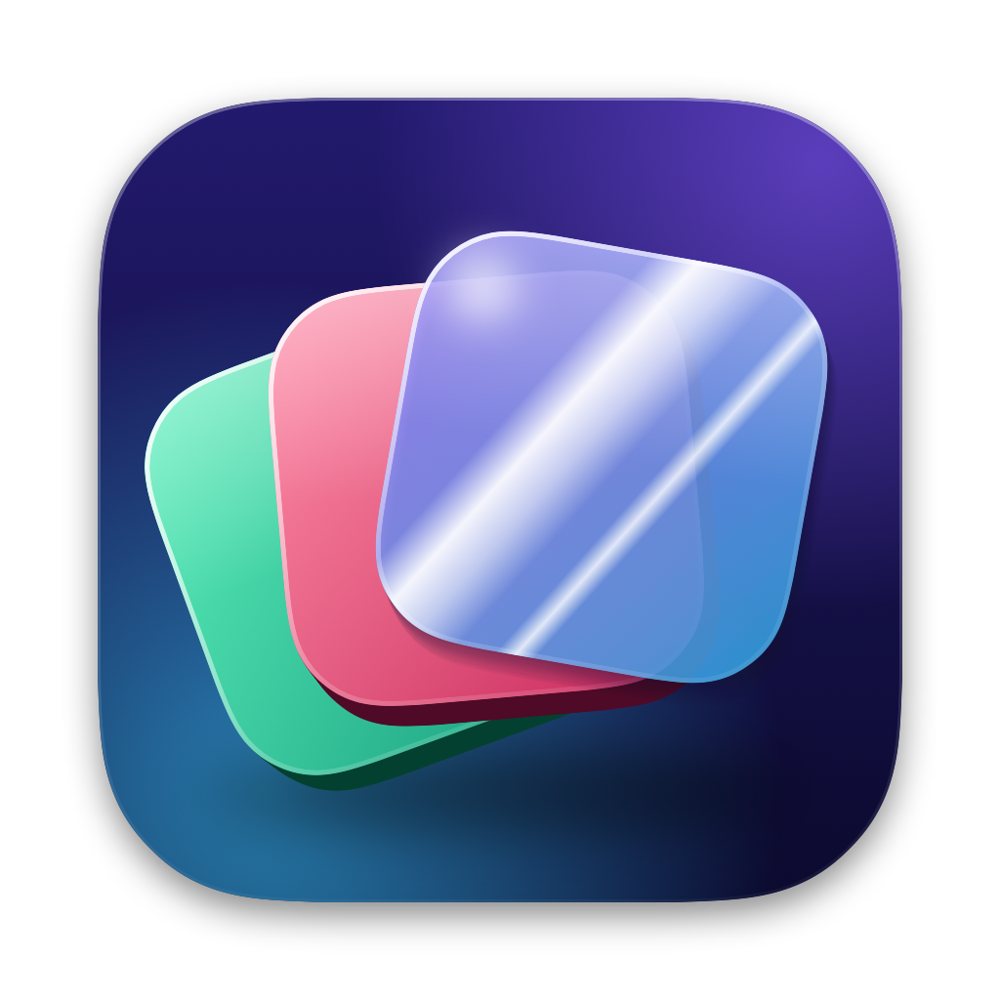
</p>

<h1 align="center">Sheen</h1>

<p align="center">
  <strong>The free, open-source Mac cleaner that feels like glass.</strong><br>
  22 tools for cleanup, protection, speed, apps and files.<br>
  No subscription. No tracking. Every line open to read.
</p>

<p align="center">
  <a href="https://github.com/danaenayati/sheen/releases/latest"></a>
  
  
  
  <a href="LICENSE"></a>
</p>

<p align="center">
  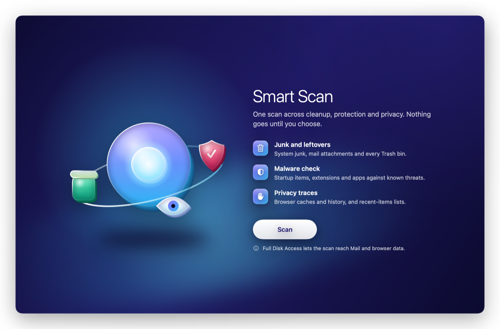
</p>

<p align="center">
  <a href="https://github.com/danaenayati/sheen/releases/latest"><strong>⬇ Download Sheen</strong></a>
  &nbsp;·&nbsp; <a href="#install">Install</a>
  &nbsp;·&nbsp; <a href="#sheen-vs-cleanmymac">Compare</a>
  &nbsp;·&nbsp; <a href="#build-it-yourself">Build it yourself</a>
</p>

---

## Why Sheen

<table>
<tr>
<td width="50%" valign="top">

### 🪟 Every tool is a room
Each section has its own colour world: indigo for Smart Scan, emerald for Cleanup, rose for Protection, ember for Performance, cobalt for Applications, violet for Files. Light and dark appearance both get the full colour.

</td>
<td width="50%" valign="top">

### 💡 The light follows you
Every tool has its own glass object, drawn in code. Move the pointer and it tilts toward you, its shine slides across the glass and its layers move at their own depths. Reduce Motion keeps it still.

</td>
</tr>
<tr>
<td valign="top">

### 📝 Says what it will do
Each tool opens with three plain bullets taken from what its code really does, so you know what it finds before you press Scan. Once you have used a tool, it opens compact and gets out of your way.

</td>
<td valign="top">

### 🛡 Safe by design
Removals go to the Trash first, a protected-paths guard checks every file, and Clean History puts a whole clean back in one click. Anything permanent asks you first.

</td>
</tr>
</table>

<p align="center">
  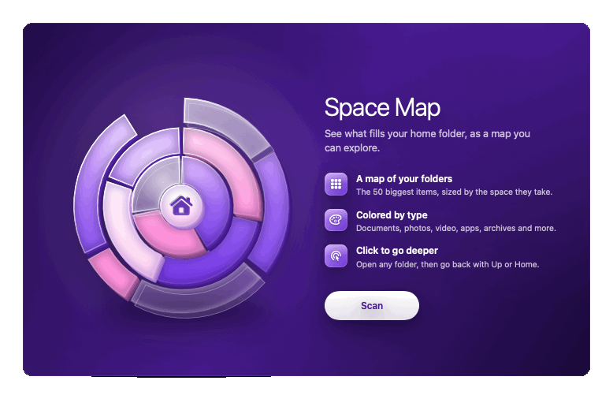
</p>

## Sheen vs CleanMyMac

|  | **Sheen** | **CleanMyMac** |
|---|:---:|:---:|
| **Price** | **Free** | Subscription, about $39.95 a year for one Mac¹ |
| **Source code** | Open (BSD-3-Clause) | Closed |
| **No tracking you can verify yourself** | ✅ [see how](#verify-no-telemetry-yourself) | Not verifiable (closed source) |
| One-click scan | ✅ Smart Scan | ✅ Smart Care |
| System junk, mail attachments, Trash bins | ✅ | ✅ |
| Malware removal | ✅ | ✅ |
| Privacy traces | ✅ | ✅ |
| Saved Wi-Fi networks | ✅ | ✅ |
| App permissions overview | ✅ (read-only) | ✅ |
| Startup items and maintenance tasks | ✅ | ✅ |
| App uninstaller and updater | ✅ | ✅ |
| Disk map | ✅ Space Map | ✅ Space Lens |
| Large and old files, duplicates | ✅ | ✅ |
| Forgotten downloads | ✅ | ✅ |
| Menu bar monitor | ✅ | ✅ |
| Similar photos | — | ✅ |
| Cloud storage cleanup | — | ✅ |
| Signed and notarized by Apple | Not yet² | ✅ |
| Mac App Store | — | ✅ |

**Also in Sheen:** developer junk finder (`node_modules`, venvs, `target`, `build`, `Pods`), Docker and Xcode simulator space, Clean History with one-click restore, a file shredder with secure erase, and browser-extension review across Chrome, Brave, Edge, Arc, Firefox and Safari.

<sub>¹ Price from MacPaw's own blog and public software listings, November 2026; check MacPaw's store for current pricing. CleanMyMac's features are taken from MacPaw's public support pages (November 2026) and refer to the version sold directly by MacPaw; the Mac App Store edition leaves some out. ² Sheen is ad-hoc signed because the project has no paid Apple Developer account yet; see <a href="#install">Install</a>.<br>CleanMyMac is a trademark of MacPaw. Sheen is an independent project and is not affiliated with or endorsed by MacPaw.</sub>

## The tools

<table>
<tr>
<td valign="top" width="20%">

**Cleanup**
- System Junk
- Mail Attachments
- Trash Bins
- Disk Hogs
- Project Junk
- Clean History

</td>
<td valign="top" width="20%">

**Protection**
- Malware Removal
- Privacy
- Browser Extensions
- Saved Wi-Fi
- Permissions

</td>
<td valign="top" width="20%">

**Performance**
- Optimization
- Maintenance

</td>
<td valign="top" width="20%">

**Applications**
- Uninstaller
- Unused Apps
- Extensions
- Updater

</td>
<td valign="top" width="20%">

**Files**
- Space Map
- Large & Old Files
- Forgotten Downloads
- Duplicates
- Shredder

</td>
</tr>
</table>

Plus **Smart Scan**, which runs cleanup, malware and privacy checks in one pass, and a **menu bar panel**.

## In your menu bar

Sheen's mark sits in the menu bar, nothing else. Click it for a quick health check: CPU, memory, disk and battery as four tiles, network speed and malware status underneath, cleanup tips and connected drives one tab away. Click a tile to open the tool that acts on it. Don't want it? Turn it off in **Settings → Show Sheen in the menu bar**.

<p align="center">
  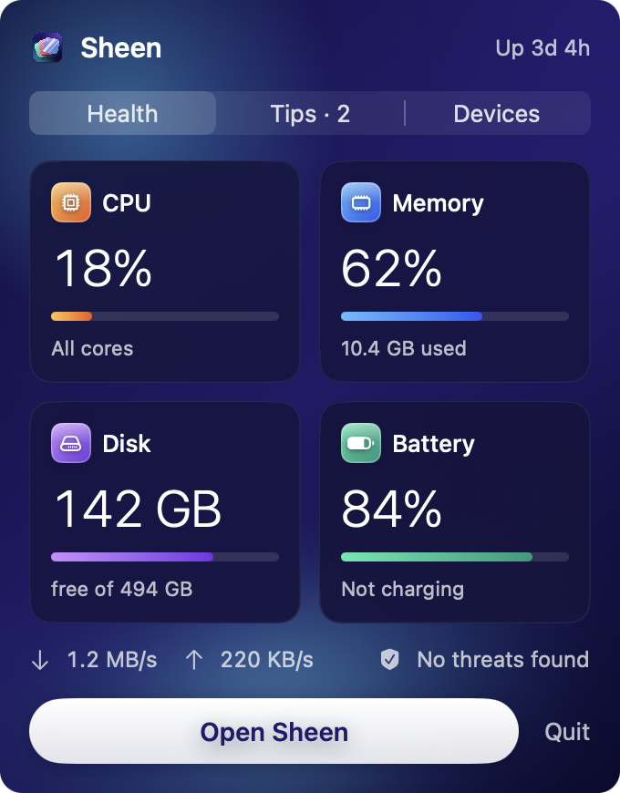
  &nbsp;&nbsp;
  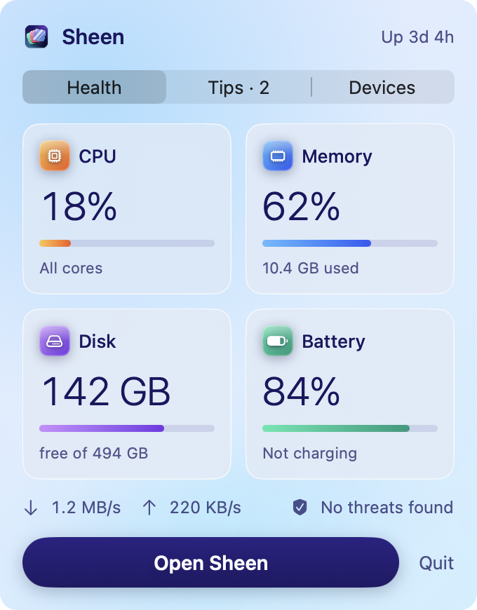
</p>

<sub>Shown with sample figures.</sub>

## A look inside

<table>
<tr>
<td>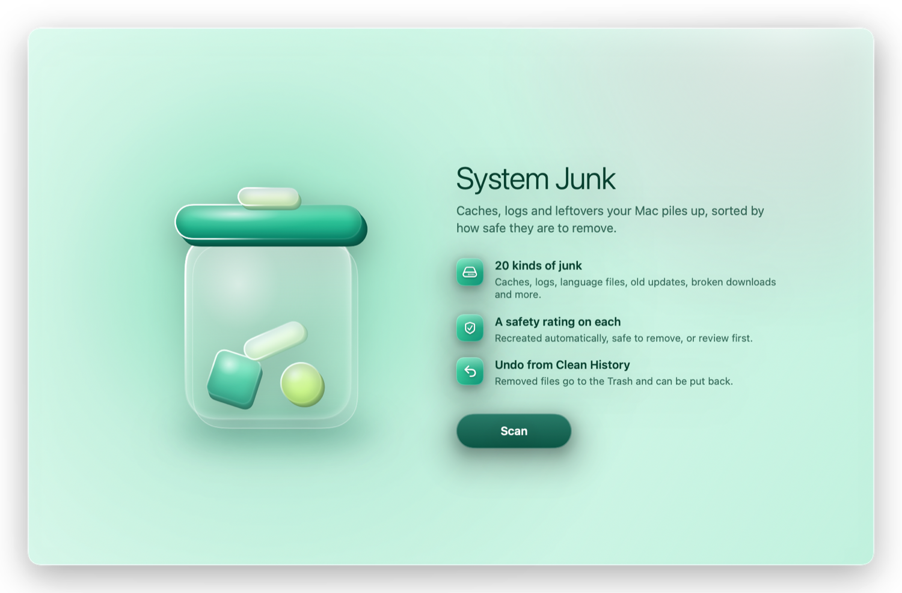</td>
<td>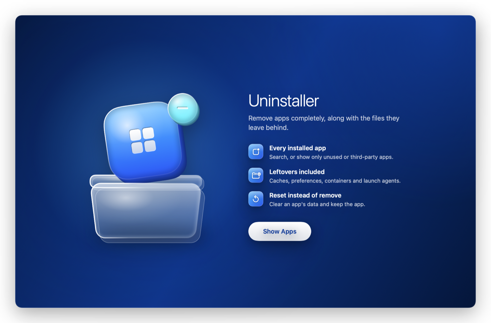</td>
</tr>
<tr>
<td>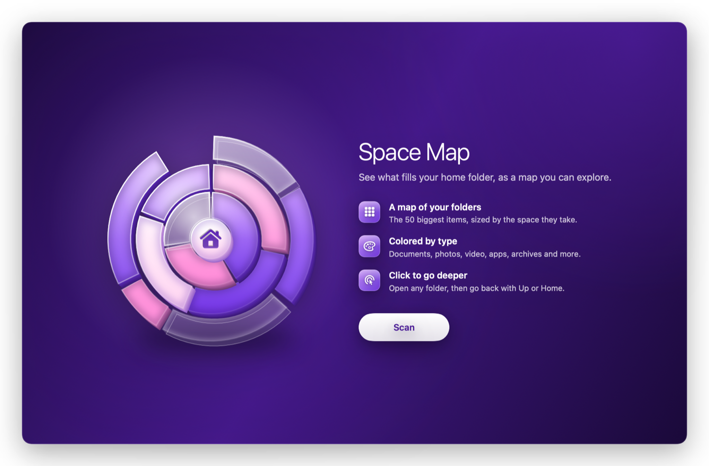</td>
<td>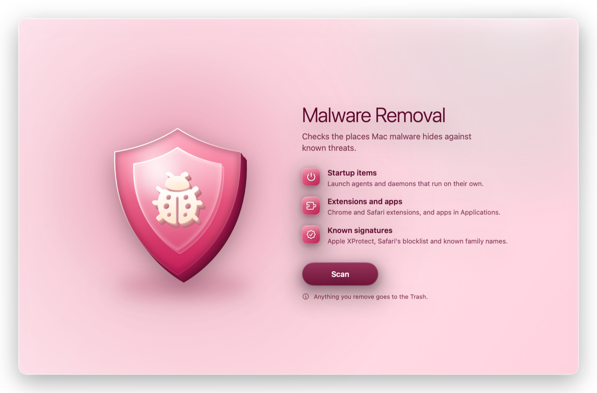</td>
</tr>
<tr>
<td>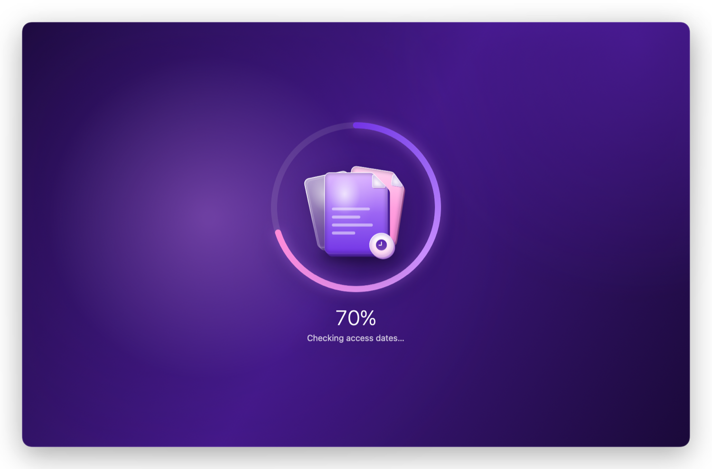</td>
<td>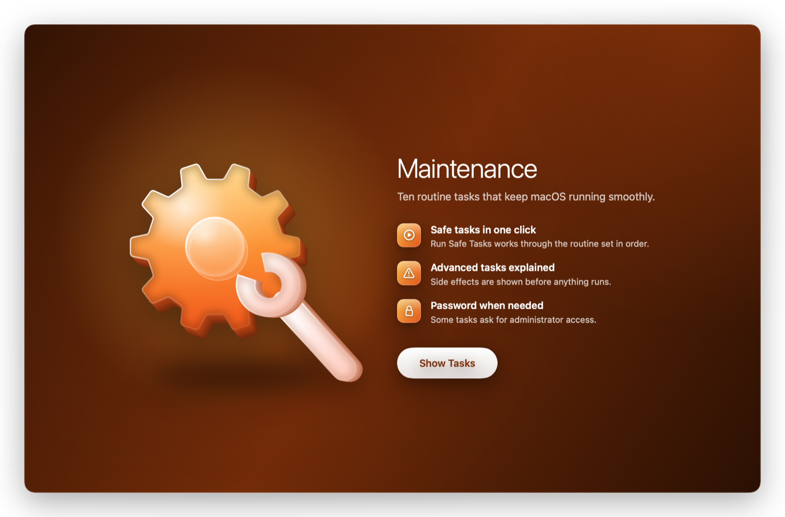</td>
</tr>
</table>

<sub>The images on this page are rendered straight from Sheen's own SwiftUI views with <code>scripts/render-showcase.sh</code>, so they always match the code.</sub>

## Install

1. On a Mac with Apple Silicon, download the latest **Sheen DMG** from [Releases](https://github.com/danaenayati/sheen/releases/latest), open it, and drag **Sheen** to **Applications**.
2. **First launch.** Sheen is not notarized by Apple yet, so macOS stops the first launch. Open **System Settings → Privacy & Security**, scroll down and click **Open Anyway** next to Sheen. Or, in Terminal:

   ```bash
   xattr -dr com.apple.quarantine /Applications/Sheen.app
   ```

3. **Full Disk Access.** Some tools (Mail, browser privacy, Trash, Permissions) need it. Add Sheen under **System Settings → Privacy & Security → Full Disk Access**.

**Or with Homebrew:**

```bash
brew tap danaenayati/sheen
brew trust danaenayati/sheen   # Homebrew asks you to trust third-party taps once
brew install --cask sheen
```

The same first-launch step applies, since Homebrew installs the same app.

Prefer not to run a downloaded app? [Build it yourself](#build-it-yourself) in two commands.

## Build it yourself

You need macOS 14 or newer and Apple's Command Line Tools (`xcode-select --install`). Xcode is not required.

```bash
git clone https://github.com/danaenayati/sheen.git
cd sheen
scripts/build-without-xcode.sh --install          # Apple Silicon, installs to /Applications
scripts/build-without-xcode.sh --dmg              # also package a DMG
```

With Xcode installed you can also use `swift build` and `swift test` directly, and build for Intel Macs with `scripts/build-without-xcode.sh --universal` (current Command Line Tools ship some Swift runtime pieces for Apple Silicon only).

### Verify no telemetry yourself

Do not take our word for it. Both the source and the app on your disk are checkable.

**1. Search the source for networking APIs**

```bash
grep -rn 'URLSession\|NSURLConnection' Sources --include='*.swift'
```

You should only see three network paths, all read-only:

- `Sources/MacCleanKit/UpdateChecker.swift`: Sheen's own update check against this repository's releases (turn it off in Settings)
- `Sources/MacClean/Modules/Updater/UpdaterModule.swift`: the check of *other apps'* update feeds, only when you open the Updater
- `Sources/MacCleanKit/MalwareBazaarFeed.swift`: the opt-in MalwareBazaar hash download. It runs only after you add your own abuse.ch Auth-Key and press Update Now in Settings. Each request sends only your Auth-Key and the query, never file hashes or paths. When a downloaded hash matches a signed file, macOS asks Apple whether its signing certificate was revoked, the same check Gatekeeper makes; that request is about the certificate, not your files

There is no analytics, crash reporter or tracker SDK anywhere in the code.

**2. Watch the running app**

```bash
lsof -i -P -n | grep -i 'MacClean\|Sheen' || echo "no network sockets"
```

Expected: no connections while you are only cleaning locally. Little Snitch or LuLu show the same thing visually.

**3. Inspect the binary you installed**

```bash
APP="/Applications/Sheen.app/Contents/MacOS/MacClean"

# Networking classes the binary imports (only URLSession appears):
nm -u "$APP" | grep -iE 'URLSession|NWConnection|CFSocket' | sort -u

# Every URL compiled into the binary:
strings -a "$APP" | grep -iE 'https?://' | sort -u
```

Expected: the only networking class is `_OBJC_CLASS_$_NSURLSession`, and the only fetched endpoints are `api.github.com/repos/danaenayati/sheen/releases/latest` and `mb-api.abuse.ch/api/v1/` (only after you add a MalwareBazaar key). Other links just open in your browser.

## Design

Sheen's look is a documented system: six colour worlds, one light source shared by every glass object, a light title voice, and motion that explains state. See [DESIGN.md](DESIGN.md). Every illustration is drawn in SwiftUI; there are no bitmap assets and no third-party artwork.

## Credits

Sheen's cleaning, scanning and safety engine comes from the open-source project [Mac Sai](https://github.com/iliyami/MacSai) (BSD-3-Clause), and its first glass styling from the [Glass Care theme](https://github.com/yuhengz117-pixel/MacSai-Themes). Sheen's interface, glass objects, icon and copy are new. Neither project endorses Sheen.

## License

[BSD-3-Clause](LICENSE). Contributions are welcome; see [CONTRIBUTING.md](CONTRIBUTING.md). Security reports: [SECURITY.md](SECURITY.md).
